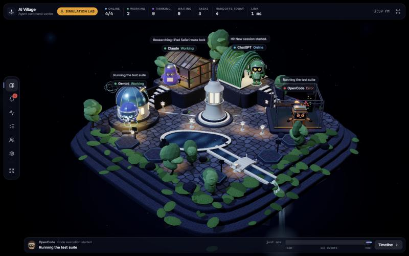
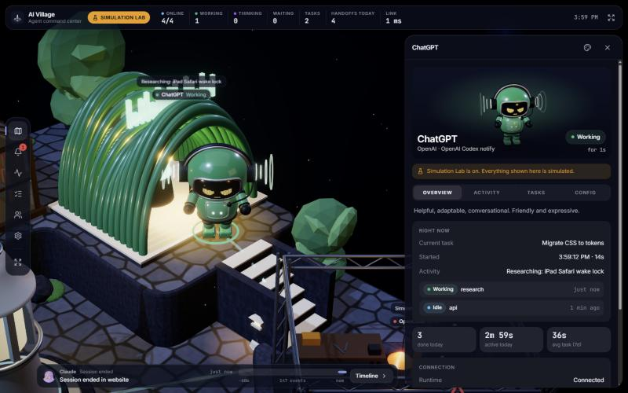

# AI Village

**A free, local-first monitor for your AI coding agents, shown as a living 3D village.**

Each agent is a character with a home on a floating island. When Claude Code edits a file,
Gemini CLI waits for your permission or a task fails, the village shows it within a second: the
character acts it out, its home lights up, and the HUD around the edges gives you the exact
numbers. Everything you see comes from **real signals only**. Nothing is guessed, simulated or
estimated unless you switch on the clearly labeled Simulation Lab.





## Features

- **Live state for every agent**: online, working, thinking, waiting for you, completed, error,
  offline and unknown, with the current task, open sessions and the latest event.
- **A 3D village** rendered in your browser (three.js): a home per core agent (Gemini's
  observatory, Claude's glass atelier, ChatGPT's ribbed Nexus, OpenCode's forge), expansion pads
  for extra agents, building lights that follow real state, and glowing packets when one agent
  hands work to another.
- **Telemetry that stays out of the way**: agents online, working, thinking, waiting, active
  tasks, handoffs today and measured connection latency, plus an activity timeline, a task list
  with durations and token counts (when the agent reports them), and alerts when an agent needs you.
- **Every screen**: desktop, iPad (landscape or portrait) and iPhone. Add it to your home screen
  as an app. Kiosk mode turns a spare tablet into an always-on status display.
- **Make it yours**: nine characters, twenty accessories, five islands (Nocturne, Sakura, Glacier,
  Ember, Verdant) and twelve emotes. Characters fidget, stretch and wave on their own while idle.
- **A shop with daily deals** for extra characters, accessories, islands and emotes, paid through
  Stripe. Everything the monitor does is free; the shop is purely cosmetic (see [docs/SHOP.md](docs/SHOP.md)).
- **Liquid Glass interface**: translucent capsule controls and panels floating over the village.
- **Private by design**: runs on your computer, reachable only from your own network, password
  protected, and never records prompt text or file contents (see [Privacy](#privacy)).

## Requirements

- [Node.js](https://nodejs.org) **24 or newer**
- Windows, macOS or Linux. Developed and tested mainly on Windows 11; macOS and Linux are
  supported but have seen less real-world use, so please report anything that breaks.
- A browser with WebGL 2 (any current Chrome, Edge, Safari or Firefox)

## Quick start

```bash
git clone https://github.com/sipherwarden/ai-village.git
cd ai-village
npm install
npm start
```

`npm start` builds the web app on the first run, then starts the hub and prints its addresses:

- **On this computer:** `http://localhost:7777`. Your first visit here creates your password.
- **On your phone or tablet (same Wi-Fi):** `http://<this computer's LAN IP>:7777`. In Safari,
  Share → **Add to Home Screen** gives you a full-screen app.

Instead of `npm start` you can double-click `start-village.cmd` (Windows) or run
`./start-village.sh` (macOS, Linux). Starting it while it is already running just opens it.

On Windows, the first start may ask whether Node.js can accept connections on **private
networks**. Allow it, or your phone and tablet cannot connect.

To start it automatically when you sign in: on Windows, put a shortcut to `start-village.cmd` in
your Startup folder (`Win+R`, then `shell:startup`). On macOS or Linux, add `start-village.sh` to
your login items or a user service.

## Connect your agents

The village starts with Gemini, Claude, ChatGPT and OpenCode. Each one stays **Unknown** until it
actually reports something.

| Agent | How it reports | What you see live |
|---|---|---|
| Claude Code (CLI and desktop) | Hooks in `~/.claude/settings.json` | Sessions, prompts, every tool, permission waits, finished turns, tokens per turn |
| Gemini CLI | Hooks in `~/.gemini/settings.json` | Sessions, prompts, tools, permission waits, finished turns |
| Codex (ChatGPT plan) | `notify` in `~/.codex/config.toml`, set up by hand (instructions in the agent's Config tab) | Finished turns only |
| OpenCode | Event stream from `opencode serve` | Connection, busy and idle, tools, permissions |
| Your own agents | HTTP push with heartbeat, HTTP polling, WebSocket, or MCP self-report | Whatever they report |
| Claude.ai, ChatGPT and Gemini chat apps | None | Not observable: these apps expose no activity |

Install the Claude Code and Gemini CLI hooks with `npm run hooks:install` (remove them with
`npm run hooks:uninstall`), or from **Agents → Agent hooks on this PC** in the app. Every change
backs up the settings file first.

For your own agents, open **Agents → Add agent** and pick an integration; each one shows the
exact request format. Agents on other machines need a per-agent ingest token, which the app issues.

## Privacy

- The hub runs on your computer and accepts connections only from this computer and private
  network addresses. It refuses public IP addresses. Do not expose it to the internet.
- The hook reporter (`hooks/emit.mjs`) sends only the event name, session id, project folder
  name, tool name and file name, and only to `127.0.0.1`. It never sends file contents or command
  arguments, and never sends prompt text unless you turn on prompt previews in Settings.
- API keys you store are encrypted on disk (Windows DPAPI, or AES-256-GCM with an owner-only key
  file on macOS and Linux) and are never sent to the browser.
- Nothing is sent to any outside service except optional checks of the providers' public status
  pages, which you can turn off in Settings (**Check provider status pages**). When you buy
  something in the shop, your browser (not the hub) talks to the shop server and Stripe.
- Emotes and idle fidgets are decoration: they never change an agent's reported state.

See [SECURITY.md](SECURITY.md) for the security model and how to report a vulnerability.

## Honesty rules the code enforces

- An agent that has never reported shows **Unknown**, never Idle or Online.
- Hook-based agents are Online only while a session is open. Quiet sessions expire after the
  timeout in Settings.
- Provider status pages are shown separately from agent activity.
- Tokens and cost show "Not provided by this integration" when no source exists.
- Speech bubbles and agent-to-agent interactions come only from real events.
- The Simulation Lab runs on a separate state engine, is labeled on every screen, and its data is
  deleted when you turn it off.

## Configuration

| Variable | Default | Purpose |
|---|---|---|
| `AI_VILLAGE_PORT` | `7777` | Port the hub listens on |
| `AI_VILLAGE_HOST` | `0.0.0.0` | Interface to listen on (`127.0.0.1` for this computer only) |
| `AI_VILLAGE_DATA` | `./data` | Database and TLS folder |
| `AI_VILLAGE_SECRETS` | your OS's app-data folder | Where encrypted secrets are stored |
| `AI_VILLAGE_TLS_CERT`, `AI_VILLAGE_TLS_KEY` | none | Certificate and key for HTTPS |
| `AI_VILLAGE_LOG` | `warn` | Server log level |

**HTTPS:** put `cert.pem` and `key.pem` in `data/tls/` (for example made with `mkcert`). HTTPS
enables system notifications and keeping an iPad screen awake in kiosk mode.

**Render quality** is automatic (high on desktops, balanced on touch devices) and lowers itself if
the frame rate drops.

## Development

```bash
npm run dev        # hub with auto-reload, plus Vite on :5173
npm test           # server tests
npm run typecheck
npm run build
```

Design labs with no data and no API calls: `/?lab=characters` (lineup, state matrix, close-ups,
silhouette test) and `/?lab=world` (the whole village with a simulated cast and time of day).

```
server/   Fastify hub: state engine, adapters, SQLite (node:sqlite), WebSocket, auth, secrets
web/      React + Tailwind interface and the 3D village
  src/engine/       three.js: creature.ts (characters), face.ts, world.ts, terrain.ts,
                    pavilions.ts, fx.ts (water, conduits, sky), runtime.ts, portrait.ts
  src/components/   Village3D.tsx (canvas, camera, badges), Shell.tsx (HUD), ProfilePanel.tsx
shared/   Types used by both
hooks/    emit.mjs, the reporter called by agent hooks
scripts/  launcher, hook installer, dev runner
```

Add a new integration by adding an adapter to `server/adapters.ts`. The cosmetic catalog and
daily-deal rules live in `shared/cosmetics.ts`; the shop server is in `shop-server/`.

[STATUS.md](STATUS.md) lists what is finished, what is partial and what is planned.

## License

[MIT](LICENSE). Free to use, change and share.
